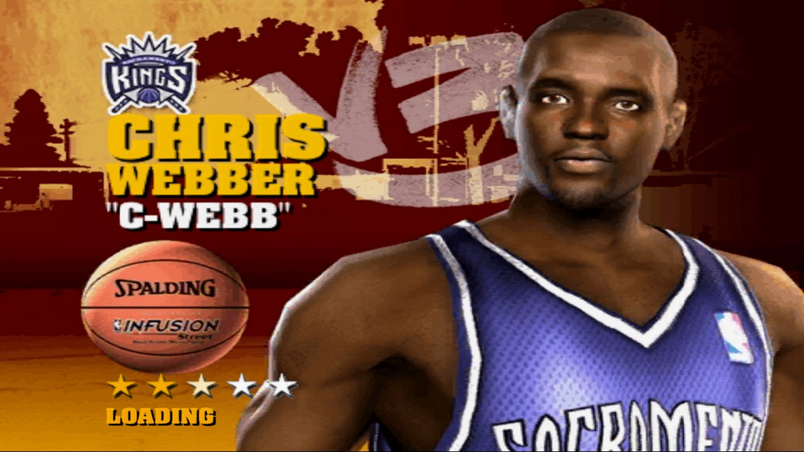
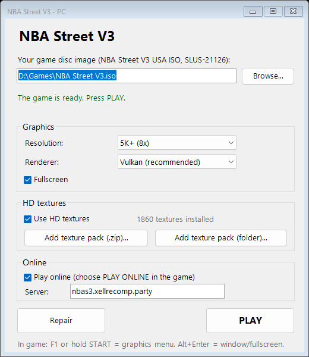

# NBA Street V3 — port nativo para PC (PS2Recomp + render de PCSX2)

[English](README.md) | **Español**

Juega a **NBA Street V3** (PS2) de forma nativa en Windows: alta resolución, texturas HD, mando y
**online funcionando**. El juego se recompila estáticamente a un programa nativo x64 con
[PS2Recomp](https://github.com/ran-j/PS2Recomp) y se dibuja en tu GPU con el render de
[PCSX2](https://github.com/PCSX2/pcsx2).

> **Este proyecto NO contiene nada del juego**: ni ISO, ni archivos del juego, ni texturas. Necesitas
> **tu propia copia** de NBA Street V3 (versión USA, SLUS-21126) en un archivo ISO.

| | |
|---|---|
|  |  |
|  |  |

<sub>Capturas de este port (Vulkan, resolución interna 4x, 16:9). NBA Street V3 © Electronic Arts.</sub>

## Cómo jugar

1. Entra en [**Releases**](https://github.com/recomp-code/street-recomp-v3/releases/latest) y descarga
   **`NBAStreetV3-PC-1.0.zip`** (es el único archivo que necesitas).
2. Descomprímelo donde quieras y haz doble clic en **`Launcher.cmd`**.
3. Pulsa **Browse...** y elige tu ISO de NBA Street V3.
4. Pulsa **Prepare game**. Esto se hace **solo una vez**: descarga lo necesario y compila el juego en
   tu PC a partir de tu ISO (unos 6 GB de descargas, 1-2 horas). Windows pedirá permiso una vez para
   instalar las herramientas de C++ de Microsoft. Una ventana muestra el progreso; ciérrala cuando
   ponga **Done**.
5. Pulsa **PLAY**. A partir de ahí, solo abre el launcher y pulsa **PLAY**.

<p align="center"></p>

En el launcher también eliges la **resolución** (hasta 5K), el **renderizador**, **pantalla completa**,
las **texturas HD** y el **online**. Jugando, **F1** o **mantener START** abre el menú gráfico y
**Alt+Enter** cambia entre ventana y pantalla completa.

¿Por qué compila el juego en vez de traerlo hecho? El programa contiene el código del propio juego
traducido a C++, así que no se puede distribuir: se genera en tu PC a partir de tu copia.

## Características

- **Ejecutable nativo x64.** El código MIPS del juego (EE) se recompila estáticamente a C++ y se
  compila con MSVC: no hay emulador de CPU en ejecución. El IOP, el audio SPU2 y el adaptador de red
  de PS2 se emulan; los microprogramas de VU1 corren en el recompilador microVU de PCSX2.
- **Render moderno por GPU** con el GS de PCSX2: Vulkan, Direct3D 11/12 u OpenGL, resolución interna
  desde 480p nativa hasta 8x (5K+), filtrado de texturas, 4:3 o 16:9 estirado, pantalla completa.
- **Packs de texturas HD**, instalados con un clic desde el launcher (ver [Texturas HD](#texturas-hd)).
- **Online recuperado** contra un servidor de la comunidad: cuentas EA, personas, ballers online,
  partidas PLAY NOW, sin abrir puertos. Ver [Modo online](#modo-online).
- **Launcher de un clic**: eliges tu ISO, preparas una vez y juegas.
- **Menú gráfico en el juego**: F1, Back+Start o mantener START 1,5 s (funciona con el mando).
- **Mandos tipo Xbox (XInput) y teclado**.
- **Memory card emulada** con partidas guardadas normales.

## Texturas HD

1. Consigue un pack de texturas HD para NBA Street V3 (formato PCSX2, normalmente un `.zip` lleno de `.png`).
2. En el launcher pulsa **Add texture pack (.zip)...** (o **(folder)...** si ya lo descomprimiste).
3. Pulsa **PLAY**. Listo: el launcher instala el pack, activa las texturas HD y se salta solo las
   pocas texturas que se sabe que estropean la imagen (menús con grano, iconos de botones rotos).

Puedes activar o desactivar las texturas HD con **Use HD textures** en el launcher o en el menú
gráfico del juego. Los packs no se incluyen aquí (se hacen a partir de las imágenes del juego).

<details>
<summary>Hacer tu propio pack (avanzado)</summary>

1. En el menú gráfico del juego pon Texturas HD en **"Activadas + volcar originales"** y recorre los
   menús y canchas que quieras; los originales se vuelcan a `Documentos\PCSX2\textures\SLUS-21126\dumps`.
2. Ejecuta `tools\texturas_preparar.ps1`: copia los volcados a `C:\NBAStreetRecomp\texturas_hd\originales`
   y aparta las texturas que no se deben reemplazar (fotogramas de vídeo, capturas dinámicas de
   memoria de vídeo que el juego reescribe cada fotograma, páginas invisibles con paleta ajena).
3. Mejora los PNG con la herramienta que quieras (p. ej. un escalador por IA), con los mismos nombres.
4. Añade la carpeta con los PNG mejorados desde el launcher (**Add texture pack (folder)...**).

</details>

## Modo online

El servicio EA Online original del juego cerró hace años; este port lo recupera. El online viene
activado por defecto en el launcher (**Play online**).

Cómo jugar un partido:

1. En el launcher deja **Play online** marcado y pulsa **PLAY**.
2. En el juego: **PLAY ONLINE** -> **YES** -> **"1 - NBA Street Online (DHCP)"** -> conectar.
   No uses "New/Edit" en esa pantalla.
3. Solo la primera vez: crea una cuenta (usuario de 4+ letras, cualquier e-mail y contraseña — solo
   se guardan en el servidor de la comunidad, **no reutilices una contraseña real**) y luego una **persona**.
4. Crea un **baller online** (Create Baller en el menú online) y guárdalo.
5. **PLAY** -> **PICKUP GAMES** -> **PLAY NOW**. Te empareja con el siguiente jugador que haga lo
   mismo; el partido empieza cuando están los dos.

No hace falta configurar el router: el tráfico del partido pasa por el servidor. Si se queda en
"connecting", permite `ps2EntryRunner.exe` en tu firewall.

<details>
<summary>Cómo funciona</summary>

- **Adaptador de red.** El adaptador de red de PS2 (DEV9/SMAP) se emula con el modo "sockets" de
  PCSX2: sin drivers ni permisos de administrador. El juego obtiene IP por DHCP y sus nombres de EA
  (`ps2nbastreet05.ea.com`, etc.) se redirigen al servidor configurado.
- **Servidor.** Un servidor de la comunidad reimplementa el protocolo de lobby de EA: cuentas,
  personas, ballers online (guardados en el servidor), partidas rápidas (PLAY NOW) y montaje del
  partido. El código del servidor no está en este repositorio.
- **Tráfico del partido.** Las dos consolas hablan normalmente P2P por UDP. Aquí cada jugador recibe
  una IP virtual y todo el tráfico pasa por el relay UDP del servidor (UDP 21003): funciona detrás de
  NAT/CGNAT. La latencia es tu ping al servidor más el del rival.
- **Configuración de red.** El launcher copia una configuración lista (`game/mc0_netcnf`) a la
  memory card emulada la primera vez que juegas online.
- Problemas: el log es `C:\NBAStreetRecomp\logs\play_err.log` ("cannot resolve server" = sin internet o DNS).

</details>

## Para desarrolladores

Lo que sigue solo hace falta para compilar o modificar el port a mano; para jugar no necesitas nada más.

| Ruta | Qué es |
|---|---|
| `Launcher.cmd` / `Launcher.ps1` | Launcher: eliges tu ISO, preparas el juego una vez, texturas HD, jugar |
| `tools/install.ps1` | Instalador de un paso que usa **Prepare game** (herramientas, fuentes, compilación) |
| `tools/install_textures.ps1` | Instalador de packs que usa **Add texture pack** (con `gshost/texture_blocklist.txt`) |
| `patches/ps2recomp.patch` | Cambios sobre PS2Recomp `2c5fbb9` (recompilador, runtime, IOP, red DEV9, SPU2...) |
| `patches/pcsx2.patch` | Cambios sobre PCSX2 `d073d75` (`pcsx2-gsrunner -live`: render en tiempo real para el juego) |
| `game/config/` | Configuración del recompilador para SLUS-21126 (solo lista de funciones y direcciones) |
| `game/overrides/` | Arreglos específicos del juego (`nba_street_v3_overrides.cpp`) |
| `game/mc0_netcnf/` | Configuración de red para la memory card emulada (online) |
| `gshost/nba_street.ini` | Opciones gráficas por defecto |
| `tools/` | Scripts de preparación, compilación, depuración y texturas (`make_patches.ps1` regenera los parches) |
| `docs/PORTING_NOTES.md` | Notas técnicas: cada bug encontrado y cómo se arregló |
| `Play.cmd` | Arranca el juego sin el launcher (`set NBA_SERVER=off` para jugar sin red) |

## Requisitos (compilar a mano)

- Windows 10/11 x64, GPU con Vulkan (o Direct3D 11/12), ~40 GB libres, 16 GB de RAM recomendados.
- **Visual Studio 2022 Build Tools** con "Desarrollo para el escritorio con C++" (MSVC v143 + Windows SDK).
- Las rutas están fijadas a **`C:\NBAStreetRecomp`**: el proyecto debe vivir ahí.
- Herramientas portables en `C:\NBAStreetRecomp\tools\` (los scripts las buscan en estas carpetas):

| Carpeta | Herramienta |
|---|---|
| `tools\mingit\` | [MinGit](https://github.com/git-for-windows/git/releases) (o Git instalado en el PATH) |
| `tools\cmake\cmake-4.4.4-windows-x86_64\` | [CMake 4.x](https://cmake.org/download/) (zip) |
| `tools\llvm\clang+llvm-20.1.8-x86_64-pc-windows-msvc\` | [LLVM 20](https://github.com/llvm/llvm-project/releases) (clang-cl, para PCSX2) |
| `tools\ninja\` | [Ninja](https://github.com/ninja-build/ninja/releases) |
| `tools\python\` | Python 3 embebible (lo pide el build de dependencias de PCSX2) |
| `tools\portablegit\` | [PortableGit](https://github.com/git-for-windows/git/releases) (aporta `bash`/`patch` para las dependencias de PCSX2) |
| `tools\7zip\` | [7-Zip](https://www.7-zip.org/) extra (`x64\7za.exe`) |

Si prefieres herramientas instaladas en el sistema, edita las rutas al principio de los `.cmd` de `tools\`.

## Compilar

Todo desde `C:\NBAStreetRecomp`. Clona este repositorio en `C:\NBAStreetRecomp\nbastreet-v3-recomp`
y copia el contenido de su carpeta `tools\` a `C:\NBAStreetRecomp\tools\` (junto a las herramientas portables).

**1. Tu juego.** Extrae tu ISO con 7-Zip en `C:\NBAStreetRecomp\game\iso\` (debe quedar
`game\iso\SLUS_211.26`) y copia la propia ISO como `C:\NBAStreetRecomp\game\NBAStreetV3.iso`
(el juego lee sectores del disco directamente).

**2. Fuentes de PS2Recomp y PCSX2 con los parches:**
```bat
powershell -ExecutionPolicy Bypass -File nbastreet-v3-recomp\tools\setup_sources.ps1
```

**3. Compilar el recompilador:**
```bat
tools\cmake\cmake-4.4.4-windows-x86_64\bin\cmake -S PS2Recomp -B PS2Recomp\out\build
tools\build_recomp.cmd
```

**4. Generar el código del juego** desde tu ELF (unos minutos; ~100.000 archivos .cpp):
```bat
powershell -ExecutionPolicy Bypass -File nbastreet-v3-recomp\tools\generate_game.ps1
```

**5. Compilar el juego** (la primera vez tarda mucho: es el ejecutable completo del juego en C++):
```bat
tools\build_runner.cmd
```
Resultado: `PS2Recomp\out\build\ps2xRuntime\Release\ps2EntryRunner.exe`. Las siguientes veces,
`tools\build_runner_only.cmd` (incremental). Log en `logs\`.

**6. Compilar el render (PCSX2 `pcsx2-gsrunner`, sin Qt):**
```bat
tools\build_pcsx2_deps.bat
tools\build_pcsx2.cmd pcsx2-gsrunner
powershell -ExecutionPolicy Bypass -File nbastreet-v3-recomp\tools\setup_gshost.ps1
```
Las dependencias (SDL3, shaderc, etc.) solo se compilan una vez. `setup_gshost.ps1` monta
`C:\NBAStreetRecomp\gshost` con el exe, las DLL, `resources` y la configuración gráfica.

**7. Jugar:** `nbastreet-v3-recomp\Play.cmd` (cópialo donde quieras).

## Uso

- **Controles**: mando Xbox/compatible (XInput) o teclado (flechas, WASD, Z/X/C/V, Q/E, 1/3, Enter = START).
- **Menú gráfico** (resolución interna, filtro, renderizador, texturas HD): **F1**, **Back+Start** o
  **mantener START 1,5 s**. Se guarda en `gshost\nba_street.ini`.
- **Pantalla completa**: Alt+Enter o F11.
- **Partidas guardadas**: `game\iso\mc0\` (memory card emulada).
- **Texturas HD**: formato de PCSX2, en `Documentos\PCSX2\textures\SLUS-21126\replacements`.
  Las instala `tools\install_textures.ps1` (el botón del launcher), que se salta los hashes de
  `gshost\texture_blocklist.txt` (capturas dinámicas de pantalla y páginas invisibles que estropean la imagen).

## Estado

Jugable de principio a fin en offline: menús, vídeos, Create Baller, partidos a 60 fps con física
correcta, audio (SPU2 emulado) y memory card. El modo online existe en el código (adaptador de red
DEV9 emulado) y se conecta al servidor de la comunidad; el código del servidor no forma parte de este repositorio.

Los bugs del recompilador encontrados (y corregidos en `patches/ps2recomp.patch`) están en
`docs/PORTING_NOTES.md`; varios afectan a cualquier juego de PS2 portado con PS2Recomp
(SQRT.S, saltos BLTZ/BGEZ de 64 bits, MMI, VU0...).

## Contribuir

Issues y pull requests bienvenidos. Antes de nada lee `docs/PORTING_NOTES.md`: explica la
arquitectura (runtime + host de PCSX2 por un anillo de memoria compartida), las herramientas de
depuración (`tools\run_scripted.ps1` para pruebas automáticas sin tocar el escritorio,
`PS2X_IOP_RAM_DUMP`, `tools\decomp.cmd` con Ghidra, etc.) y cada problema resuelto.

**Nunca** subas archivos del juego (ISO, ELF, código generado en `game\output` o
`ps2xRuntime\src\runner`, texturas extraídas, partidas). Para cambios en PS2Recomp o PCSX2, regenera el
parche correspondiente con `git diff` sobre el commit fijado.

## Licencia y créditos

GPL-3.0 (igual que PS2Recomp y PCSX2). Basado en
[PS2Recomp](https://github.com/ran-j/PS2Recomp) de ran-j y colaboradores y en
[PCSX2](https://github.com/PCSX2/pcsx2) (GS, microVU, DEV9). NBA Street V3 es propiedad de
Electronic Arts; este proyecto no está afiliado a EA y no distribuye ningún contenido del juego.
