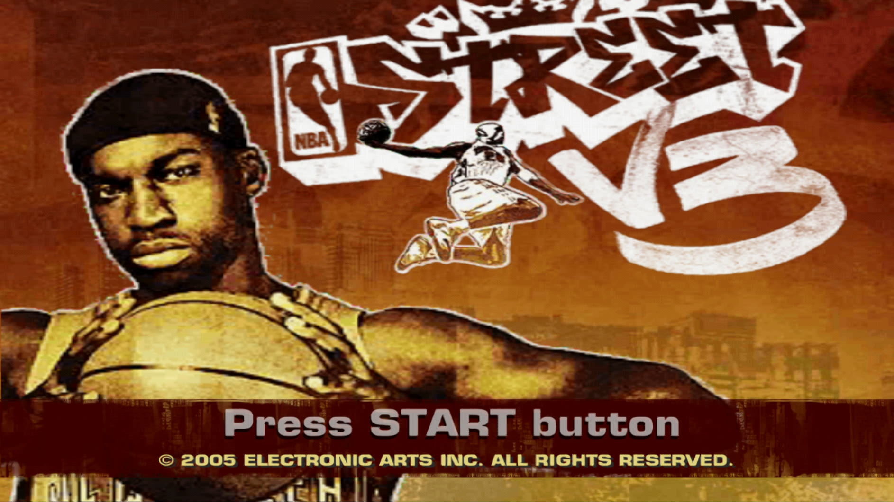
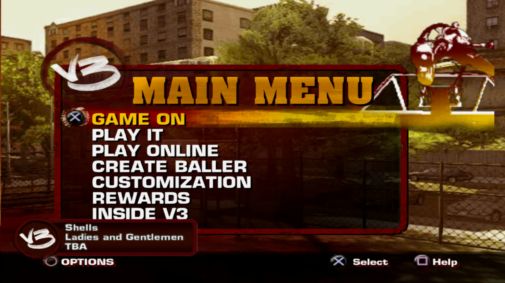
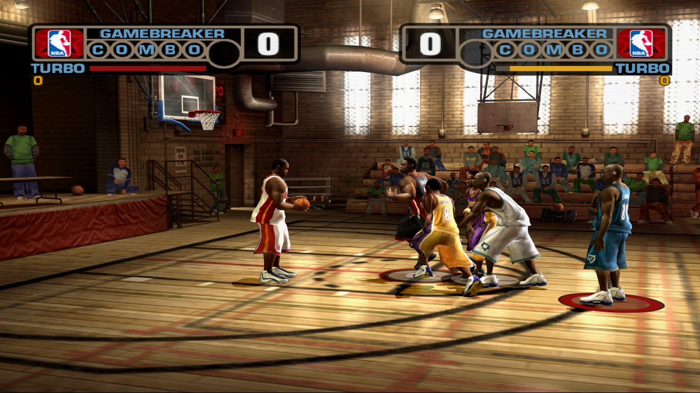
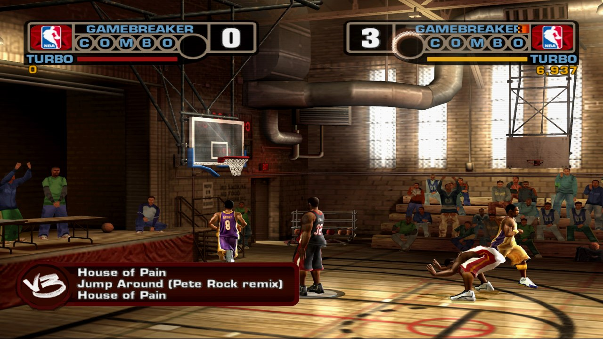

# NBA Street V3 — native port for PC and Mac

**English** | [Español](README.es.md)

Play **NBA Street V3** (PS2) as a native program on **Windows** and **macOS (Apple Silicon)**: high
resolution, HD textures, controller support and **working online play**. The game is recompiled to
native code with [PS2Recomp](https://github.com/ran-j/PS2Recomp) and drawn on your GPU by the
[PCSX2](https://github.com/PCSX2/pcsx2) renderer.

> **You need your own copy** of NBA Street V3 (USA, SLUS-21126) as an ISO file. Nothing from the game
> is included: it is built on your computer from your copy.

| | |
|---|---|
|  |  |
|  |  |

**[▶ PS2 vs. this port, comparison video](docs/videos/comparison.mp4)**

## Features

- **Native on Windows (x64) and macOS (Apple Silicon, arm64).** The game's code is recompiled to
  native code: no CPU emulator while you play.
- **Full speed:** matches at 60 fps.
- **Modern rendering:** up to 8x internal resolution (5K), texture filtering, 16:9, fullscreen.
  Windows: Vulkan, Direct3D 11/12 or OpenGL, with AMD FSR 1 or NVIDIA DLSS. Mac: Metal.
- **HD textures** (fan pack, installed automatically on Windows).
- **Online play** against a community server, no router setup needed.
- **Controller** and keyboard (Windows: Xbox-style/XInput; Mac: Xbox, PlayStation or MFi).
- **In-game graphics menu:** F1, Back+Start or hold START for 1.5 s.
- Normal **saves** on an emulated memory card.

## Play on Windows

1. Download **`NBAStreetV3-PC-<version>.zip`** from
   [**Releases**](https://github.com/recomp-code/street-recomp-v3/releases/latest) and unzip it.
2. Double-click **`Launcher.cmd`**, click **Browse...** and choose your ISO.
3. Click **Prepare game** (only once: it downloads the tools and builds the game, 1-2 hours).
4. Click **PLAY**.

## Play on Mac

Needs a Mac with **Apple Silicon** (M1 or newer), **macOS 14.4** or later, about **30 GB** free and:

```sh
xcode-select --install                     # Apple's command line tools (once)
/bin/bash -c "$(curl -fsSL https://raw.githubusercontent.com/Homebrew/install/HEAD/install.sh)"   # Homebrew, if you don't have it
```

Then:

```sh
mkdir -p ~/NBAStreetRecomp && cd ~/NBAStreetRecomp
git clone https://github.com/recomp-code/street-recomp-v3.git nbastreet-v3-recomp
nbastreet-v3-recomp/tools/macos/install.sh ~/Downloads/NBAStreetV3.iso    # once, ~1 hour
nbastreet-v3-recomp/tools/macos/play.sh                                    # play
```

`install.sh` installs what is missing with Homebrew (CMake, Ninja, FFmpeg), downloads the sources and builds the graphics host and the game from your ISO. Run it again
after a `git pull` to update.

## Controls

| | Windows | Mac |
|---|---|---|
| D-pad / left stick | Arrows / WASD | Arrows / WASD |
| Square, Cross, Circle, Triangle | Z, X, C, V | Z, X, C, V |
| L1, R1, L2, R2 | Q, E, 1, 3 | Q, E, 1, 3 |
| START / SELECT | Enter / Backspace | Return / Delete |
| Graphics menu | F1 | F1 |
| Fullscreen | Alt+Enter or F11 | Option+Return or Ctrl+Cmd+F |

Controller: A = Cross, B = Circle, X = Square, Y = Triangle.

## Online

In the game: **PLAY ONLINE** → **YES** → **"1 - NBA Street Online (DHCP)"**. The first time, create an
account (any e-mail; **don't reuse a real password**) and a **persona**, then an **online baller**.
**PLAY** → **PICKUP GAMES** → **PLAY NOW** matches you with the next player.

## For developers

| Path | What it is |
|---|---|
| `patches/ps2recomp.patch` | Changes to PS2Recomp `2c5fbb9` (recompiler, runtime, IOP, network, audio, macOS) |
| `patches/pcsx2.patch` | Changes to PCSX2 `d073d75` (live renderer `pcsx2-gsrunner -live`, macOS window, arm64 microVU) |
| `game/` | Recompiler config for SLUS-21126, game fixes, network settings |
| `tools/` | Windows scripts (`install.ps1`, builds, debugging, textures) |
| `tools/macos/` | Mac scripts (`install.sh`, `play.sh`, `build.sh`, `build_pcsx2.sh`, `run_scripted.sh`) |
| `docs/BUILDING.md` | Manual Windows build, HD textures, how online works |
| `docs/PORTING_NOTES.md` | Technical notes: architecture and every bug fixed |

Never upload game files (ISO, ELF, generated code, extracted textures, saves).

## License and credits

GPL-3.0, like PS2Recomp and PCSX2. Based on [PS2Recomp](https://github.com/ran-j/PS2Recomp) by ran-j
and contributors and [PCSX2](https://github.com/PCSX2/pcsx2) (GS, microVU, DEV9). The Mac version runs
VU1 on the arm64 microVU recompiler from [ARMSX2](https://github.com/ARMSX2/ARMSX2). NBA Street V3 is
property of Electronic Arts; this project is not affiliated with EA and includes no game content.
